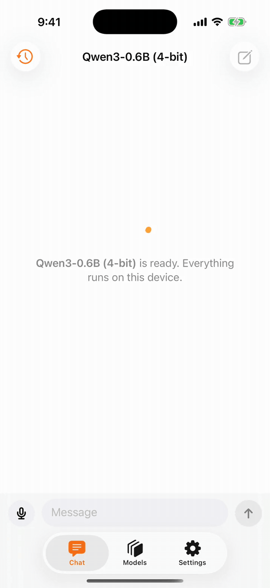
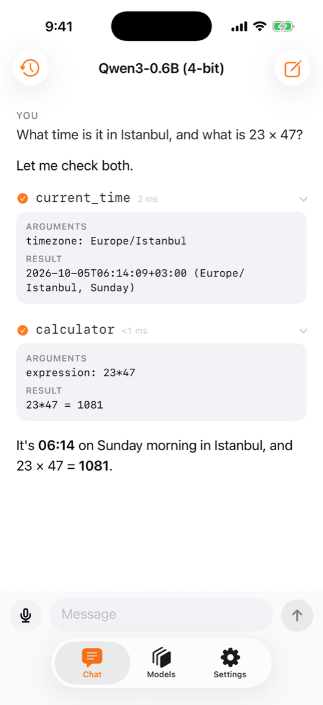
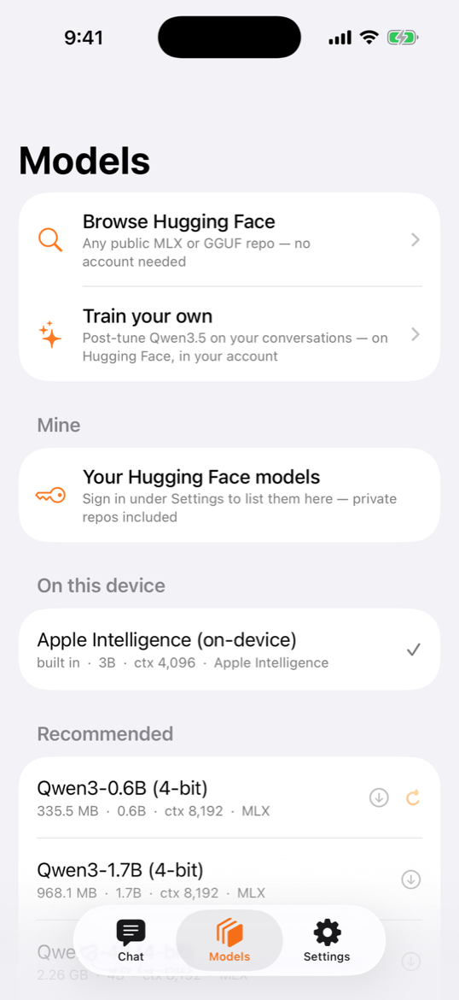
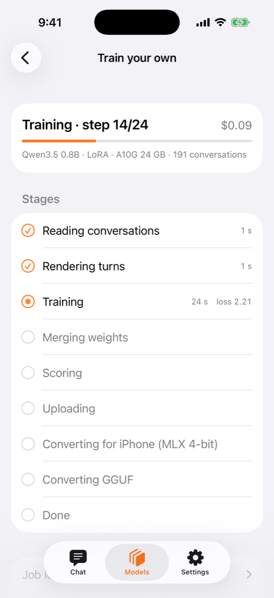

<div align="center">


# loopl

**Agents that run on the iPhone.** A local model, the agent loop, and the phone's own abilities as tools —
offline, no account, no cloud.

[](https://testflight.apple.com/join/uUNjfzW9)
[](Package.swift)
[](Package.swift)
[](Package.swift)
[](https://loopl.dev)

<picture>
  <source media="(prefers-color-scheme: dark)" srcset="docs/assets/readme/hero-dark.gif">
  
</picture>

<sub>Real capture · iPhone 16 Pro · Qwen3-0.6B, 4-bit, on device · 2× speed</sub>

</div>

## Why

- **On the device.** MLX, llama.cpp or Apple Foundation Models run the model. Prompts, tools and answers stay on the phone.
- **The phone is the toolbox.** Image and voice generation, transcription, translation, vision, torch, haptics, deep links — one line hands them to the model.
- **A small, honest loop.** Model → tools → model, until the model answers. Errors go back to the model; approvals pause the loop. Swift 6, Foundation only at the core.

## Quickstart

```swift
.package(url: "https://github.com/cagataycali/loopl", from: "0.1.0")
```

```swift
import Loopl
import LooplRuntimes
import LooplAppleTools

let model = MLXModel()                                   // or GGUFModel(), AppleFoundationModel()
try await model.load(spec, from: weights) { _ in }

let agent = Agent(model: model, tools: AppleTools.available)   // what this iPhone can do
for try await event in agent.stream("Torch on, and how do I say 'where is the exit?' in Turkish?") {
    if case .text(let chunk) = event { print(chunk, terminator: "") }
}
```

| Product | |
|---|---|
| `Loopl` | `Agent`, `Tool`, `Model`, hooks, structured output, checkpoints, tracing — Foundation only |
| `LooplRuntimes` | MLX (Metal, vision), llama.cpp (GGUF), Apple Foundation Models |
| `LooplAppleTools` | `generate_image`, `generate_voice`, `transcribe`, `translate`, `describe_image`, `flashlight`, `vibrate`, `open_app` |
| `LooplUI` | SwiftUI transcript, tool rows, approval card |

[Get started](https://loopl.dev/start/) · [Write a tool](https://loopl.dev/sdk/tools/) · [API reference](https://loopl.dev/api/)

## The app

The SDK, shipped as a free iOS app. Everything below runs on the phone.

<table>
  <tr>
    <td align="center" width="33%">
      <picture>
        <source media="(prefers-color-scheme: dark)" srcset="docs/assets/readme/tool-dark.png">
        
      </picture>
      <br><sub><b>Tools, shown.</b> Every call, its arguments, its result.</sub>
    </td>
    <td align="center" width="33%">
      <picture>
        <source media="(prefers-color-scheme: dark)" srcset="docs/assets/readme/models-dark.png">
        
      </picture>
      <br><sub><b>Any model.</b> The catalog, any Hugging Face repo, your private ones.</sub>
    </td>
    <td align="center" width="33%">
      <picture>
        <source media="(prefers-color-scheme: dark)" srcset="docs/assets/readme/train-running-dark.png">
        
      </picture>
      <br><sub><b>Your own model.</b> Post-tune on your conversations.</sub>
    </td>
  </tr>
</table>

- **Models** — MLX and GGUF from Hugging Face; add a token to list and download your private repos.
- **Share** — select conversations, push them to a private Hugging Face dataset.
- **Train your own** — launch a Hugging Face job from the phone, see the cost first, get the model back in Models.
- **External drive** — keep models on a USB-C drive when the phone is full.
- **Voice and vision** — record with the mic and the model calls `transcribe`; attach a photo for vision models.
- **Tools** — torch, haptics, open apps, image and voice generation, translation; risky calls ask first.

<p align="center">
  <a href="https://testflight.apple.com/join/uUNjfzW9"></a>
</p>

## Models

| Model | Runtime | 4-bit | Tool calls | |
|---|---|---:|:-:|---|
| [Qwen3-0.6B](https://huggingface.co/mlx-community/Qwen3-0.6B-4bit) | MLX | 335 MB | ✓ | default |
| [Qwen3-1.7B](https://huggingface.co/mlx-community/Qwen3-1.7B-4bit) | MLX | 968 MB | ✓ | 41 tok/s on iPhone 16 Pro |
| [Qwen3 1.7B · Q4_K_M](https://huggingface.co/unsloth/Qwen3-1.7B-GGUF) | GGUF | 1.11 GB | ✓ | 33 tok/s on iPhone 16 Pro |
| [Qwen3.5 2B](https://huggingface.co/mlx-community/Qwen3.5-2B-4bit) | MLX | 1.75 GB | ✓ | vision |
| [loopl 4B](https://huggingface.co/cagataydev/loopl-4b-4bit) | MLX | 3.03 GB | ✓ | post-tuned for loopl · vision · gated |

Up to 4B at 4-bit fits an 8 GB iPhone. Any public MLX or GGUF repo loads the same way. [All models →](https://loopl.dev/models/)

The **loopl** models — Qwen3.5 0.8B/2B/4B post-tuned for this loop, vision kept, with their dataset and cards — are one [Hugging Face collection](https://huggingface.co/collections/cagataydev/loopl-on-device-agents-swift-6ac51395b13a9c41d4932eaf).

## How it works

Model → tools → model, until the model answers. No iteration cap. A failed call returns to the model as an error result, so it can fix the call; a tool that needs approval pauses the loop until you answer. [The agent loop →](https://loopl.dev/sdk/agent/)

## Build from source

```sh
swift test                                                     # SDK, macOS
brew install xcodegen && xcodegen generate -s App/project.yml  # the app → App/LooplApp.xcodeproj
scripts/fetch-llama-xcframework.sh --with-sim                  # once, for GGUF
```

## Docs

[loopl.dev](https://loopl.dev) · [Get started](https://loopl.dev/start/) · [The app](https://loopl.dev/app/) · [Models](https://loopl.dev/models/) · [FAQ](https://loopl.dev/faq/) · [Changelog](https://loopl.dev/changelog/)

<p align="center"><sub>Made by <a href="https://github.com/cagataycali">@cagataycali</a>.</sub></p>
