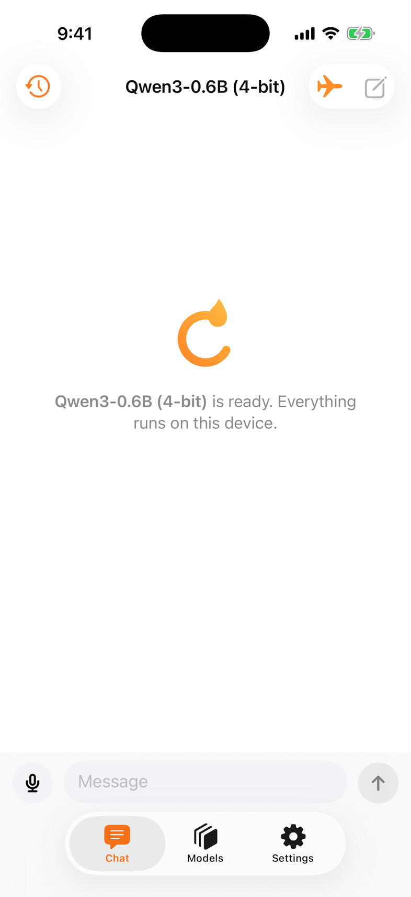
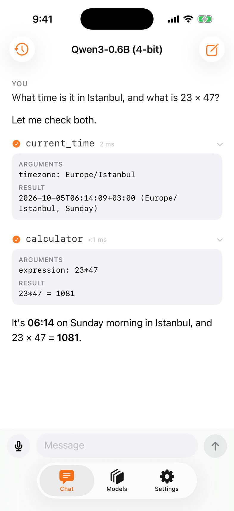
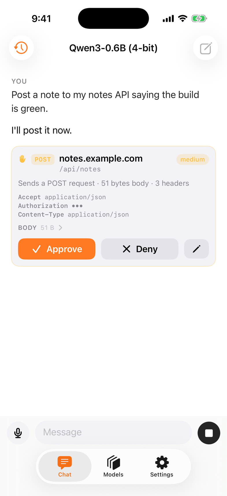
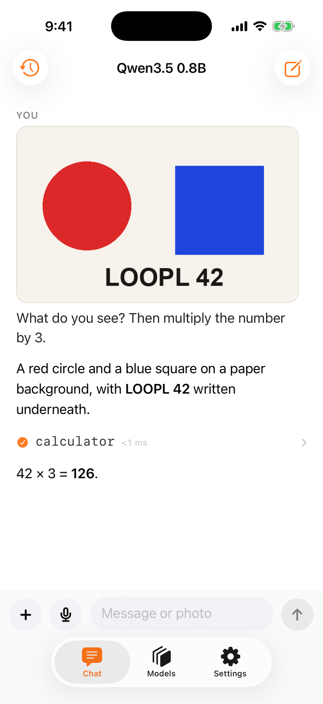
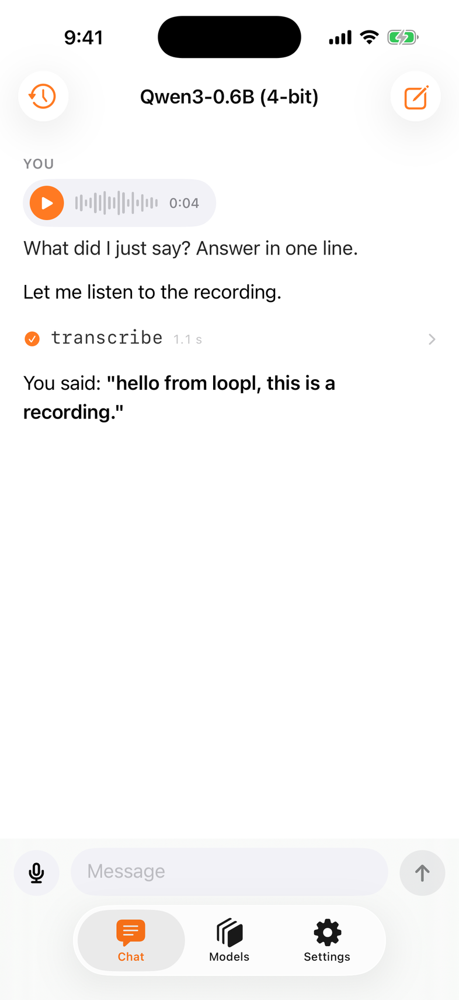
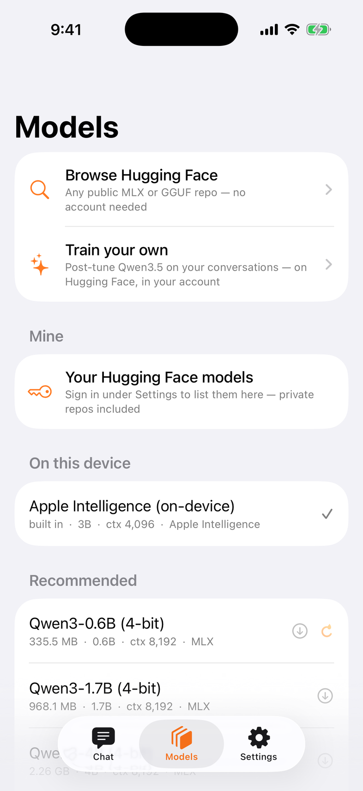

# The app

Free, no sign-in, no analytics. The first launch fetches a small model; from then on you talk to an agent that uses the phone — with the network off if you like.

<a class="l-btn l-btn--ink l-btn--tf" href="https://testflight.apple.com/join/uUNjfzW9">Get it on TestFlight</a><a class="l-link" href="https://github.com/cagataycali/loopl">Build from source</a>

Public beta · iOS 18+ · the App Store listing follows the 1.0 review.

<figure class="l-shot">

<picture><source srcset="../assets/app2/offline-dark.webp" type="image/webp" media="(prefers-color-scheme: dark)"><source srcset="../assets/app2/offline-dark.png" media="(prefers-color-scheme: dark)"><source srcset="../assets/app2/offline-light.webp" type="image/webp"></picture>

<figcaption>Ready, offline, on this device.</figcaption></figure>
<figure class="l-shot">

<picture><source srcset="../assets/app2/tool-dark.webp" type="image/webp" media="(prefers-color-scheme: dark)"><source srcset="../assets/app2/tool-dark.png" media="(prefers-color-scheme: dark)"><source srcset="../assets/app2/tool-light.webp" type="image/webp"></picture>

<figcaption>Tool rows open to arguments and results.</figcaption></figure>
<figure class="l-shot">

<picture><source srcset="../assets/app2/approval-dark.webp" type="image/webp" media="(prefers-color-scheme: dark)"><source srcset="../assets/app2/approval-dark.png" media="(prefers-color-scheme: dark)"><source srcset="../assets/app2/approval-light.webp" type="image/webp"></picture>

<figcaption>Writes ask first. Deny, and the model is told.</figcaption></figure>
<figure class="l-shot">

<picture><source srcset="../assets/app2/vision-dark.webp" type="image/webp" media="(prefers-color-scheme: dark)"><source srcset="../assets/app2/vision-dark.png" media="(prefers-color-scheme: dark)"><source srcset="../assets/app2/vision-light.webp" type="image/webp"></picture>

<figcaption>Photos go to vision models.</figcaption></figure>
<figure class="l-shot">

<picture><source srcset="../assets/app2/audio-dark.webp" type="image/webp" media="(prefers-color-scheme: dark)"><source srcset="../assets/app2/audio-dark.png" media="(prefers-color-scheme: dark)"><source srcset="../assets/app2/audio-light.webp" type="image/webp"></picture>

<figcaption>Record a take; the model calls transcribe.</figcaption></figure>
<figure class="l-shot">

<picture><source srcset="../assets/app2/models-dark.webp" type="image/webp" media="(prefers-color-scheme: dark)"><source srcset="../assets/app2/models-dark.png" media="(prefers-color-scheme: dark)"><source srcset="../assets/app2/models-light.webp" type="image/webp"></picture>

<figcaption>Any public repo, your private ones, or Apple's model.</figcaption></figure>

| | |
|---|---|
| **Chat** | a document, not bubbles: streaming text, folded thinking, tool rows with timing, image attachments, a mic that records a take for `transcribe`, Stop. |
| **Models** | the catalog plus **Browse Hugging Face** — search, see size, context and whether it fits, download. Apple's model on iOS 26. |
| **Settings** | system prompt, which tools, what asks first, **offline mode**, [**Storage**](storage.md) — models on the phone or a USB-C drive. |
| **History** | finished conversations. Select a few → [Share to Hugging Face](share-to-hugging-face.md): reviewed, redacted, into a private dataset of yours. |

## Tools

Fewer tools make a better agent — every tool is one more thing a small model can pick wrongly, so the app ships only what earns its place, one line each. Settings turns any of them off.

| | |
|---|---|
| `current_time` · `calculator` | any time zone; exact arithmetic |
| `remember` · `recall` | notes the agent keeps between chats, on the device |
| `http` | any HTTPS request — writes ask first |
| `device_info` | battery, storage, model, OS |
| `generate_image` | a picture from a prompt (Image Playground) |
| `generate_voice` | speaks with on-device voices, Personal Voice included |
| `transcribe` | speech to text, offline. Tap the mic in the composer, record, send — the model sees `[audio attached: …]` and decides to call it; nothing is transcribed behind its back |
| `translate` | Apple's offline translation packs |
| `describe_image` | scene labels, faces, barcodes on an attached photo (Vision) |
| `flashlight` · `vibrate` | torch on/off/dimmed; haptic patterns |
| `open_app` | another app via deep link, with context — asks first unless allow-listed |

## Requirements

iOS 18+, 8 GB RAM recommended — the app checks memory and disk before a download. MLX needs a device; GGUF also runs on the simulator. Apple's model needs iOS 26 with Apple Intelligence on.

## Motion

Nothing spins. Text fades in by chunk, tool rows open on a spring, details zoom out of the row you tapped, the mark draws itself once at launch. Under Reduce Motion everything is a plain cross-fade.

## Built on the SDK

The app is `App/` in the repository — `Agent` and `Transcript` from `Loopl`, the three runtimes, the iPhone tools and the `LooplUI` components. Read it as the worked example.
