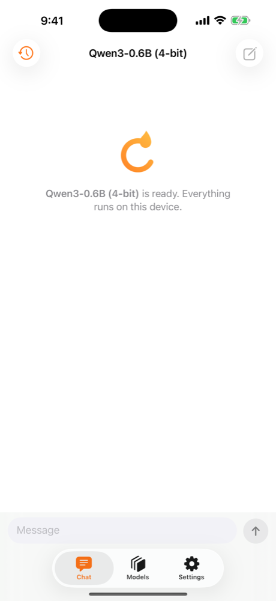
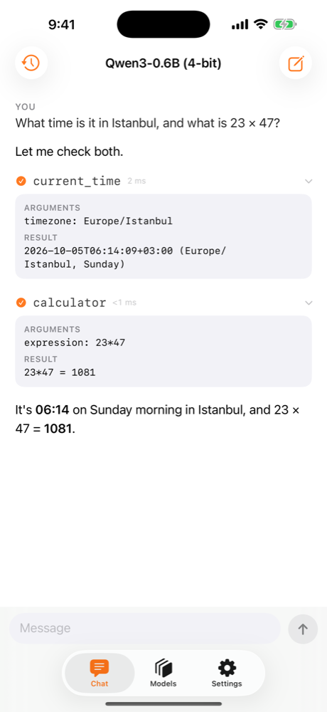
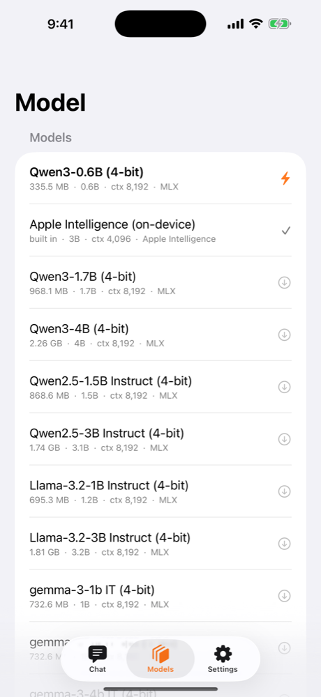
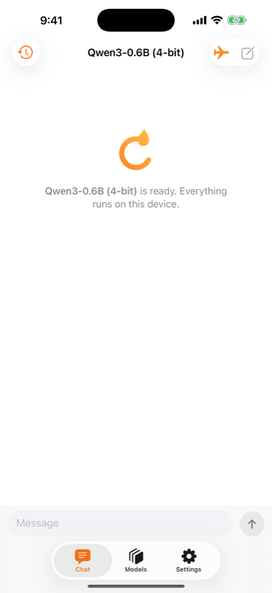
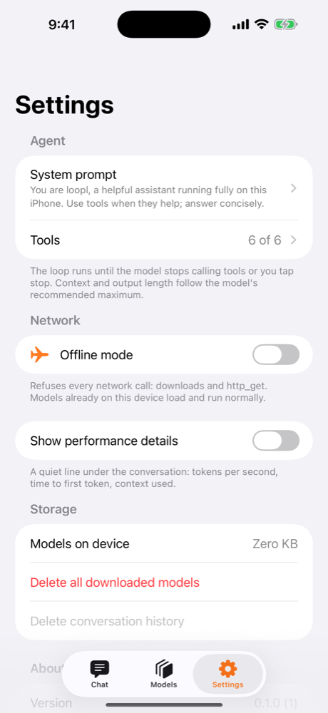

# The loopl app

A free iOS app that runs the SDK end to end: the first launch downloads a small public model, then you talk to an
agent that can use tools — on the phone, offline, with nothing to sign in to. **No account. No login. No analytics.**
It is the reference client for the SDK and the quickest way to feel what an on-device agent is like.

<a class="loopl-badge" href="https://github.com/cagataycali/loopl/releases" title="App Store listing — coming soon (TestFlight first)">
:fontawesome-brands-apple:<small>Free · coming soon on the</small><b>App Store</b>
</a>
[Build it yourself](../getting-started/run-on-device.md){ .loopl-btn .loopl-btn--ghost }

!!! info "Availability"
    The App Store badge is a placeholder until the listing is approved; TestFlight comes first. Until then the app
    builds from the repo with one script (see *Run on a device*). This page is updated the moment the store URL exists.

<figure markdown>
{ loading=lazy }
<figcaption>Ready. The default model is on the phone; the status line says so.</figcaption>
</figure>
<figure markdown>
{ loading=lazy }
<figcaption>Answers stream as a document — no bubbles, Markdown and code render as they arrive.</figcaption>
</figure>
<figure markdown>
{ loading=lazy }
<figcaption>Tool calls are quiet rows — name, duration, ✓ — that expand to arguments and result.</figcaption>
</figure>
<figure markdown>
{ loading=lazy }
<figcaption>The Model list: tap to switch, ⚡ marks the loaded one, Apple Intelligence is built in on iOS 26.</figcaption>
</figure>
<figure markdown>
{ loading=lazy }
<figcaption>Airplane mode changes nothing: a model on disk keeps answering.</figcaption>
</figure>
<figure markdown>
{ loading=lazy }
<figcaption>Settings. No token, no account, no iteration cap to tune.</figcaption>
</figure>

## Screens

| Tab / screen | What it does |
|---|---|
| **Chat** | A single conversation rendered as a document: your turn under a small **YOU** label, the agent's answer as readable body text with Markdown and code blocks, a streaming caret, tool calls as inline rows (name · ms · ✓) that expand on tap, a folded *Thinking…* row for models that reason out loud. **↑** sends, **■** stops the loop, swipe down dismisses the keyboard. The title shows the loaded model; the top-left clock opens **History** (swipe left to delete, long-press to copy), top-right starts a new conversation. |
| **Models** | The catalog grouped by runtime (MLX · Apple Intelligence · GGUF · llama.cpp): size, parameters, context budget. Tap a row to download and switch; ⚡ marks the loaded model; swipe left deletes its files. Progress shows inline in Chat, never in a modal. |
| **Settings** | **Agent** — system prompt, tools on/off (6 built in). **Network** — offline mode (refuses every network call). **Show performance details** — a quiet footer line with tok/s, time to first token and context used (off by default). **Storage** — models on device, delete all, clear conversation history. **About** — version, [privacy](../privacy.md). |

### First launch

The app downloads `mlx-community/Qwen3-0.6B-4bit` (≈335 MB) automatically, with progress inline at the top of the
chat, loads it, and remembers it; every later launch reloads the last model you used. No picker to get through before
the first message. Pick a bigger model in **Models** when you want one — Qwen3-1.7B is the sweet spot on an 8 GB phone.

### What the loop looks like in the app

Ask *"What time is it in Istanbul, and what is 23 × 47?"*: the model writes a short sentence, calls `current_time`
and `calculator` **at the same time** (two rows appear together), reads both results and answers. That is one pass of
the [event loop](../sdk/event-loop.md); a harder question simply takes more rounds. There is no iteration cap and no
"max iterations" setting — **■** is the cap.

## Identity

| | |
|---|---|
| Bundle ID | `technology.tiny.loopl` |
| Price | Free · no in-app purchases |
| Account | none · no sign-in anywhere · no Hugging Face token |
| Models | public, non-gated Hugging Face repositories only, downloaded anonymously |
| Distribution | TestFlight first, then the App Store (the badge above lights up when the listing exists) |
| Support | [loopl.dev](https://loopl.dev) · [GitHub issues](https://github.com/cagataycali/loopl/issues) |
| Privacy | [loopl.dev/privacy](../privacy.md) — Data Not Collected |

## Requirements

- iOS 18.0+. For Apple Intelligence (Apple Foundation Models): iOS 26 on an eligible device with it enabled.
- ≥ 6 GB RAM for the small models, 8 GB recommended; the catalog's `minRAMGB` is checked before a download.
- Network only for the first download of each model. [Offline mode →](offline.md)

## Design

The app is built from the same `LooplUI` package you can use yourself — `AgentTranscriptView`, `ToolCallCard`,
`TokenMeter`, `ModelPickerRow`, `DownloadProgressRow`, the `LooplMark` — on the `LooplDesign` tokens: flame accent,
SF Symbols, Dynamic Type up to the accessibility sizes, VoiceOver labels on every control, spring animations for
streaming and tool rows, haptics when a tool completes, a split-view layout on iPad.
