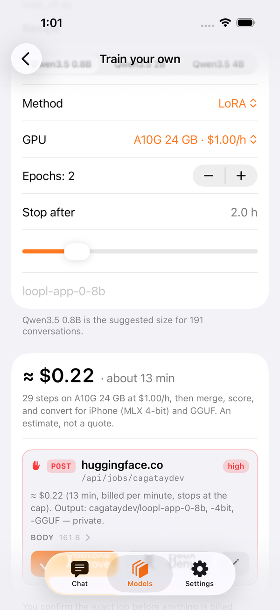
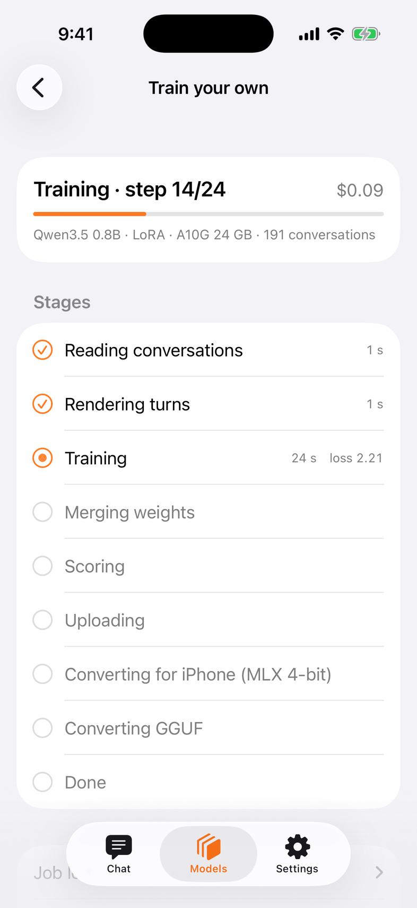
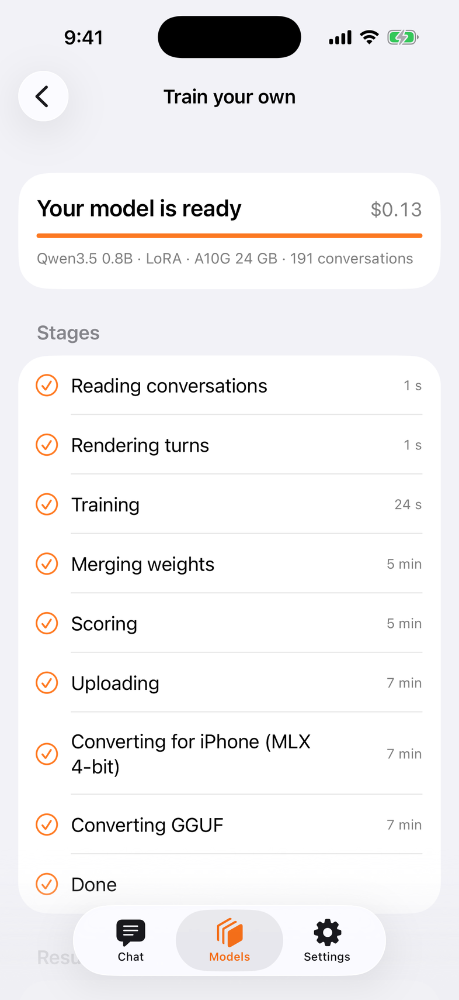

# Train your own

Your conversations → your private dataset → one GPU job → a model that is yours, back on the phone. The app does the plumbing; Hugging Face does the compute and bills **your** account per minute.

**Models › Train your own.** Needs a Hugging Face *write* token in Settings › Hugging Face and at least one dataset you shared from History.

<figure markdown>
{ loading=lazy }
<figcaption>Nothing starts before you confirm the exact job and its cost.</figcaption>
</figure>
<figure markdown>
{ loading=lazy }
<figcaption>Live: step, loss, dollars so far, each stage with its time.</figcaption>
</figure>
<figure markdown>
{ loading=lazy }
<figcaption>Held-out loss before → after. One tap adds the 4-bit model.</figcaption>
</figure>

## What happens

1. **Your conversations** — pick a dataset you shared (History › Share to Hugging Face). The app reads the shards and counts the conversations.
2. **How it trains** — three things to glance at: **Base model** (`Qwen3.5 0.8B / 2B / 4B`, suggested by dataset size: < 300 → 0.8B, ≤ 2 000 → 2B — or one of your own
   models under *Continue a model*), **Epochs: Auto (recommended)**, and a name. The footer says the whole plan in one paragraph of plain words. GPU, method and a
   fixed 1–4 epochs sit under **More options**, collapsed; *Auto* names what it picked (`Auto · A10G 24 GB`).
3. **Estimate** — one sentence: *≈ $0.30 · about 9 minutes · stops by itself if it runs past 18 minutes.* Steps × measured seconds-per-step on that GPU, plus
   install, scoring and the two conversions; honest, not a quote, it leans long. The stop is automatic — **twice the estimate, never under 15 minutes** — and is
   passed to Hugging Face as the job's timeout, so a runaway job can cost at most twice what the sentence says. Nothing to set.
4. **Confirm** — the same approval card the agent shows for an `http` call: `POST huggingface.co/api/jobs/<you>`, the flavor, the same estimate sentence, the script arguments. Deny and nothing is sent.
5. **Job** — the app commits `train/loopl_sft.py` into your dataset repo and launches it with `uv run`. The script trains, merges, scores on held-out conversations, pushes `<you>/<name>` (weights), `-4bit` (MLX, for the phone) and `-GGUF` — all private.
6. **Result** — eval loss before → after, how often the tuned model picked the right tool, and *Add to Models*. The repos also appear under Models › Mine.

## Keep going — rounds and epochs

A tuned model is a base too. Two controls on the How-it-trains card make training a thing you *keep doing* rather than do once:

- **Continue a model.** Pick one of your Mine models and the next job trains on top of it — round 2, round 3… The badge tells you the round; the model card
  carries the whole lineage (`Qwen3.5-0.8B → loopl-app-sim → loopl-app-sim-r2`). The script trains from the **bf16** twin of the 4-bit model you run on the phone —
  training from 4-bit weights is refused, and a model without a bf16 twin is named as "can't continue". Round ≥ 2 defaults to LoRA (r32, lr 5e‑5) and
  **replays every shard** of the dataset so round 1 is not forgotten; turn *Learn from everything I've shared so far* off to train on the new ones only.
- **Epochs: Auto (recommended).** Up to 3 passes, scored on held-out conversations after each; the checkpoint with the lowest loss is kept and training stops the
  moment loss rises. The guide under *More options* is the one we measured: **under 200 conversations 3–4 · 200–1 000 → 2 · over 1 000 → 1–2.** Pick 1–4 by
  hand when you know better. The result card draws held-out loss per epoch and marks the epoch that was kept.

Related chats from the same day are trained together as well as on their own — the script's call, not a setting (`loopl_sft.py --stitch`, default `day` since 1.2.4: measured 0.281 vs 0.297 held-out loss against separate-only on the same 74 conversations; the job plan line reports how many it stitched).

Measured, round 2 from the app: base `loopl-app-sim` (itself trained from the app), 74 conversations, epochs auto → 3 trained, best epoch 2 —
A10G, 334 s, ≈ $0.10, held-out loss 0.58 → 0.22, tool calls 12/12, vision kept. The result lists in Mine as **round 2** and can be continued again.

## Cost guide

| base | GPU | 200 conversations | 1 000 | 5 000 |
|---|---|---|---|---|
| 0.8B LoRA | A10G $1.00/h | ≈ $0.25 · 13 min | ≈ $0.50 · 30 min | ≈ $1.90 · 1.9 h |
| 2B full | A100 $2.50/h | ≈ $0.80 · 20 min | ≈ $2.30 · 55 min | ≈ $10 · 4 h |
| 4B LoRA | A100 $2.50/h | ≈ $1.00 · 25 min | ≈ $2.80 · 1.1 h | ≈ $12 · 5 h |

Measured: 191 conversations, 0.8B LoRA, 2 epochs on an A10G — 8 min, $0.13, held-out loss 2.38 → 2.15. With pictures: 74 conversations (14 with images), 0.8B LoRA on an A10G — 6 min, ≈ $0.10, held-out loss 0.75 → 0.29; the result shows up in Mine with its **vision** badge and describes photos on the phone.

**Vision is kept, not tuned.** The export keeps the base model's vision tower, so a model trained from conversations with pictures still sees; the training itself learns from the text of those turns.

## For SDK users

`TrainingPlan` → `TrainingEstimate` (`sentence`, `capSeconds` = the automatic stop, `TrainingPlan.summary(user:)` = the plan in words); `TrainingLaunch.jobSpec` builds the job body; `TrainingSession` uploads the script, creates the job through `HFHubClient` and polls `TrainingProgress` (the script's `[loopl] stage=…` lines). The token travels only as the job's HF_TOKEN secret. The training script lives in [loopl-train](https://github.com/cagataycali/loopl-train) (`train/loopl_sft.py` ≥ 1.2.4 — the MLX export keeps the vision tower, stitching by day is the default), bundled with the app byte-for-byte.

---

<a class="l-btn l-btn--ink l-btn--tf" href="https://testflight.apple.com/join/uUNjfzW9">Get it on TestFlight</a><a class="l-link" href="index.md">The app</a>

