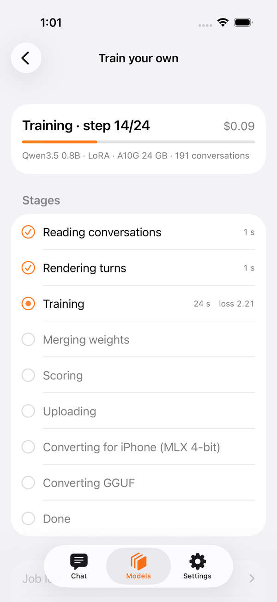
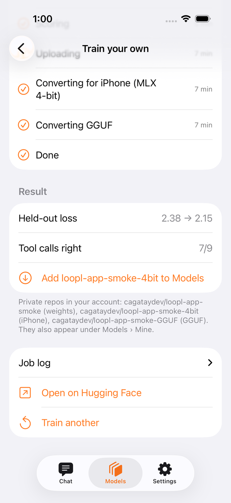

# Train your own

Your conversations → your private dataset → one GPU job → a model that is yours, back on the phone. The app does the plumbing; Hugging Face does the compute and bills **your** account per minute.

**Models › Train your own.** Needs a Hugging Face *write* token in Settings › Hugging Face and at least one dataset you shared from History.

<figure markdown>
{ loading=lazy }
<figcaption>Nothing starts before you confirm the exact job and its cost.</figcaption>
</figure>
<figure markdown>
{ loading=lazy }
<figcaption>Live: step, loss, dollars so far, each stage with its time.</figcaption>
</figure>
<figure markdown>
{ loading=lazy }
<figcaption>Held-out loss before → after. One tap adds the 4-bit model.</figcaption>
</figure>

## What happens

1. **Dataset** — pick one you shared (History › Share to Hugging Face). The app reads the shards and counts the conversations.
2. **Recipe** — base `Qwen3.5 0.8B / 2B / 4B` (suggested by dataset size: < 300 → 0.8B, ≤ 2 000 → 2B), LoRA or full fine-tune, GPU, epochs, and a **hard stop** in hours — Hugging Face kills the job there, so the cap is also the most it can cost.
3. **Estimate** — steps × measured seconds-per-step on that GPU, plus install, scoring and the two conversions. Honest, not a quote; it leans long.
4. **Confirm** — the same approval card the agent shows for an `http` call: `POST huggingface.co/api/jobs/<you>`, the flavor, the cap, the script arguments. Deny and nothing is sent.
5. **Job** — the app commits `train/loopl_sft.py` into your dataset repo and launches it with `uv run`. The script trains, merges, scores on held-out conversations, pushes `<you>/<name>` (weights), `-4bit` (MLX, for the phone) and `-GGUF` — all private.
6. **Result** — eval loss before → after, how often the tuned model picked the right tool, and *Add to Models*. The repos also appear under Models › Mine.

## Cost guide

| base | GPU | 200 conversations | 1 000 | 5 000 |
|---|---|---|---|---|
| 0.8B LoRA | A10G $1.00/h | ≈ $0.25 · 13 min | ≈ $0.50 · 30 min | ≈ $1.90 · 1.9 h |
| 2B full | A100 $2.50/h | ≈ $0.80 · 20 min | ≈ $2.30 · 55 min | ≈ $10 · 4 h |
| 4B LoRA | A100 $2.50/h | ≈ $1.00 · 25 min | ≈ $2.80 · 1.1 h | ≈ $12 · 5 h |

Measured: 191 conversations, 0.8B LoRA, 2 epochs on an A10G — 8 min, $0.13, held-out loss 2.38 → 2.15.

## For SDK users

`TrainingPlan` → `TrainingEstimate`; `TrainingLaunch.jobSpec` builds the job body; `TrainingSession` uploads the script, creates the job through `HFHubClient` and polls `TrainingProgress` (the script's `[loopl] stage=…` lines). The token travels only as the job's HF_TOKEN secret. The training script lives in [loopl-train](https://github.com/cagataycali/loopl-train) (`train/loopl_sft.py` ≥ 1.1.0 — the MLX export keeps the vision tower), bundled with the app byte-for-byte.
