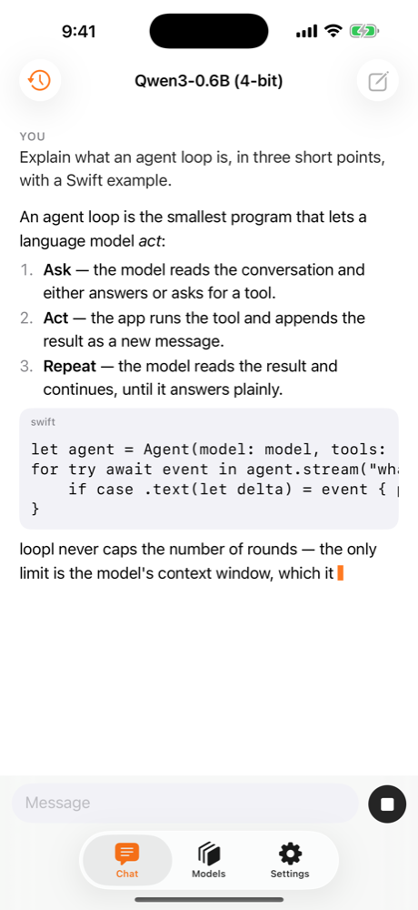

<div class="loopl-home" markdown>

# loopl

<section class="loopl-hero" markdown>

<div markdown>

<span class="loopl-kicker">Swift · on-device · open source</span>

<h1 class="loopl-hero__title">Agents that run<br><em>on the phone</em>.</h1>

<p class="loopl-hero__lead">
<strong>loopl</strong> is a Swift agent SDK for on-device models, and a free iOS app built on it. The Strands event loop with no iteration cap. Any public Hugging Face model. No cloud, no account.
</p>

<div class="loopl-cta" markdown>
<a class="loopl-btn loopl-btn--primary" href="app/">Get the app</a>
<a class="loopl-btn loopl-btn--ghost" href="https://github.com/cagataycali/loopl">GitHub</a>
</div>

<p class="loopl-hero__meta">Free · on TestFlight now, App Store listing pending · iOS 18+ · Swift 6, SwiftPM · MLX, Apple Foundation Models, llama.cpp</p>

</div>

<div class="loopl-demo" data-play aria-label="A real agent run captured on an iPhone 16 Pro">
<div class="loopl-demo__bar"><b>Qwen3-1.7B · 4-bit · MLX</b><span>iPhone 16 Pro · offline-capable</span></div>
<p class="loopl-demo__you loopl-demo__step">you</p>
<p class="loopl-demo__q loopl-demo__step">what time is it in Istanbul and what is 23*47? then remember the answer under the key 'proof' and recall it</p>
<div class="loopl-demo__tool loopl-demo__step" style="animation-delay:.4s"><b>current_time</b> Europe/Istanbul <i>Mon 5 Oct 13:50 <span class="ok">✓</span></i></div>
<div class="loopl-demo__tool loopl-demo__step" style="animation-delay:.55s"><b>calculator</b> 23*47 <i>1081 <span class="ok">✓</span></i></div>
<div class="loopl-demo__tool loopl-demo__step" style="animation-delay:.7s"><b>remember</b> proof <i>remembered <span class="ok">✓</span></i></div>
<div class="loopl-demo__tool loopl-demo__step" style="animation-delay:.85s"><b>recall</b> proof <i>proof: 1081 <span class="ok">✓</span></i></div>
<div class="loopl-demo__a loopl-demo__step" style="animation-delay:1.2s"><p>1081<span class="loopl-caret" aria-hidden="true"></span></p></div>
<p class="loopl-demo__foot loopl-demo__step" style="animation-delay:1.5s">2 cycles · 4 tools, concurrent · 41 tok/s · TTFT 2.3 s · ctx 787 / 8192 — the app's <code>--selftest</code> run, 2026-10-05</p>
</div>

</section>

<div class="loopl-strip" markdown>
<span>:material-wifi-off: works in airplane mode</span>
<span>:material-account-off: no account, ever</span>
<span>:material-chart-line-variant: zero analytics</span>
<span>:material-all-inclusive: no iteration cap</span>
<span>:material-source-branch: open source</span>
</div>

<section class="loopl-sec" markdown>
<span class="loopl-kicker">How it works</span>
## One loop, until the job is done
A faithful Swift port of the Strands event loop. The context window and your Stop button are the only bounds.

<div class="loopl-grid" markdown>
<div class="loopl-step" markdown>
<span class="loopl-step__n">1</span>
### Stream
The model streams text and tool-use blocks; `Transcript` renders each delta as it lands.
</div>
<div class="loopl-step" markdown>
<span class="loopl-step__n">2</span>
### Run tools
Every call in the turn runs concurrently; results go back as one message.
</div>
<div class="loopl-step" markdown>
<span class="loopl-step__n">3</span>
### Recurse
While the stop reason is `toolUse`, call the model again. `endTurn` yields the `AgentResult`.
</div>
</div>
</section>

<section class="loopl-sec" markdown>
<span class="loopl-kicker">SDK</span>
## Twelve lines to an agent
`Agent`, `Tool`, `Model`, `Message`, `AgentEvent` — a small typed surface. Actors and async streams all the way down.

=== "Agent"

    ```swift
    // snippet: compile
    import Loopl

    func ask(_ model: any Model) async throws -> String {
        let agent = Agent(model: model,
                          tools: [CurrentTimeTool(), CalculatorTool()],
                          systemPrompt: "You are a concise assistant.")
        let result = try await agent("What time is it in Istanbul, and what is 23 × 47?")
        return result.text                                // 2 cycles: one tool round, then the answer
    }
    ```

=== "Tool"

    ```swift
    // snippet: compile
    import Loopl
    import Foundation

    struct Battery: Tool {
        let name = "battery_level"
        let description = "The device's battery level in percent."
        let parameters = ToolSchema.object([:])
        func call(_ args: [String: JSONValue]) async throws -> String { "87 %" }
    }
    ```

=== "Stream"

    ```swift
    // snippet: compile
    import Loopl

    func show(_ agent: Agent, _ prompt: String) async throws {
        for try await event in agent.stream(prompt) {
            switch event {
            case .text(let delta):        print(delta, terminator: "")
            case .toolStarted(let use):   print("→ \(use.name)")
            case .toolResult(let r):      print("← \(r.content)")
            default: break
            }
        }
    }
    ```

[Get started →](start.md){ .loopl-btn .loopl-btn--ghost }

</section>

<section class="loopl-sec" markdown>
<span class="loopl-kicker">Runs offline</span>
## Three runtimes, one protocol
Measured on real hardware with the app's self-test — single runs, not averages.

<div class="loopl-grid" markdown>
<div class="loopl-stat" markdown><b>41 tok/s</b><span>Qwen3-1.7B 4-bit · MLX Swift · iPhone 16 Pro</span></div>
<div class="loopl-stat" markdown><b>33 tok/s</b><span>Qwen3-1.7B Q4_K_M · llama.cpp (GGUF) · iPhone 16 Pro</span></div>
<div class="loopl-stat" markdown><b>0 MB</b><span>Apple Foundation Models · iOS 26 · nothing to download</span></div>
</div>

<div class="loopl-models" markdown>
<span>Qwen3 0.6B · 1.7B · 4B</span><span>Llama 3.2 1B · 3B</span><span>Gemma 3 1B · 4B</span><span>Phi-4-mini</span><span>SmolLM3</span><span>DeepSeek-R1 1.5B</span><span class="more">+ any public Hugging Face repo</span>
</div>

[Models & runtimes →](sdk/models.md){ .loopl-btn .loopl-btn--ghost }
</section>

<section class="loopl-sec" markdown>
<span class="loopl-kicker">The app</span>
## Free. No login. Nothing collected.

<div class="loopl-grid--2 loopl-grid" markdown>
<div class="loopl-phone"></div>
<div markdown>
First launch fetches Qwen3-0.6B (335 MB) by itself. Then: a document-style transcript, tool rows you can expand, a Models tab that browses Hugging Face, and an offline switch that refuses every network call.

- **No account, no token** — public models, anonymous download.
- **No analytics, no servers** — App Store label: *Data Not Collected*.
- **Open source** — the app is the SDK's worked example.

[About the app →](app/index.md){ .loopl-btn .loopl-btn--primary }
[Privacy →](privacy.md){ .loopl-btn .loopl-btn--ghost }
</div>
</div>
</section>

<footer class="loopl-footer" markdown>
<span>© 2026 Çağatay Çalı</span>
<a href="start/">Get started</a> <a href="sdk/agent/">SDK</a> <a href="models/">Models</a> <a href="app/">App</a> <a href="privacy/">Privacy</a> <a href="faq/">FAQ</a> <a href="changelog/">Changelog</a> <a href="api/">API</a> <a href="https://github.com/cagataycali/loopl">GitHub</a>
<span>Built on the <a href="https://github.com/strands-agents">Strands</a> event loop · <a href="DESIGN/">Design tokens</a></span>
</footer>

</div>
