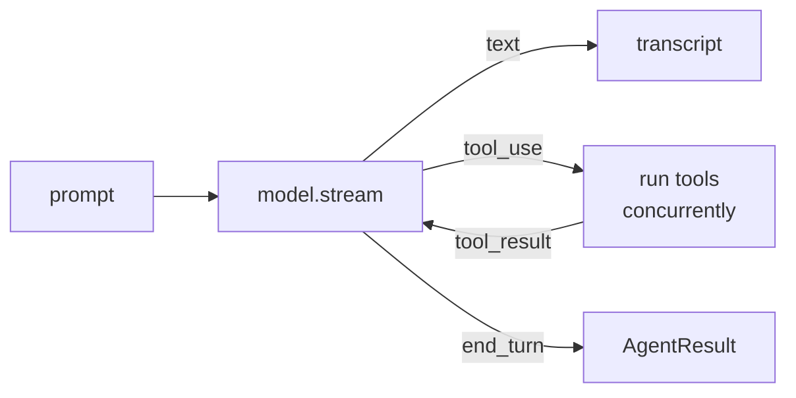

# Agent & event loop

`Agent` is an actor. Give it a `Model` and some tools; call it for the answer or stream every event.

```swift
// snippet: compile
import Loopl

func ask(_ model: any Model) async throws {
    let agent = Agent(model: model,
                      tools: [CurrentTimeTool(), CalculatorTool()],
                      systemPrompt: "You are a concise assistant.")

    let result = try await agent("What time is it in Istanbul, and what is 23 × 47?")
    print(result.text)                               // the final assistant text
    print(result.stopReason)                         // .endTurn
    print(result.metrics.cycleCount,                 // model calls in this invocation
          result.metrics.toolCallCount,              // tools that ran
          result.metrics.accumulatedUsage.totalTokens)
}
```

## The loop



1. **Stream** the model. Text deltas are yielded as they arrive; tool-use blocks are assembled.
2. **Run tools** — all calls in the turn, concurrently (`ConcurrentToolExecutor`). Results are appended as a user message.
3. **Recurse** while the stop reason is `toolUse`. The only bounds are the context window and cancellation. No `maxIterations`, no loop detector — same as Strands.

Also ported: throttle retries (`ModelRetryStrategy`, 6 attempts, 4 → 240 s backoff), context-overflow trimming via the [conversation manager](hooks.md), and `maxTokens` recovery — the partial turn is kept and `MaxTokensReachedError` is thrown so you can simply call again:

```swift
// snippet: compile
import Loopl

func askResilient(_ agent: Agent, _ prompt: String) async throws -> AgentResult {
    do { return try await agent(prompt) }
    catch is MaxTokensReachedError { return try await agent() }      // the partial turn is already in history
}
```

## Stream

`agent.stream(_:)` yields `AgentEvent`s — the same names as Strands' typed events, as a Swift enum.

```swift
// snippet: compile
import Loopl

func show(_ agent: Agent, _ prompt: String) async throws {
    for try await event in agent.stream(prompt) {
        switch event {
        case .text(let delta):          print(delta, terminator: "")
        case .reasoning(let delta):     print("💭 \(delta)", terminator: "")
        case .toolStarted(let use):     print("\n→ \(use.name) \(use.input)")
        case .toolResult(let r):        print("← \(r.name): \(r.content.prefix(80))")
        case .throttle(let s):          print("⏳ model busy, retrying in \(Int(s)) s")
        case .forceStop(let why):       print("✗ \(why)")
        case .result(let r):            print("\n— \(r.stopReason), \(r.metrics.cycleCount) cycles")
        default: break
        }
    }
}
```

| `AgentEvent` | when |
|---|---|
| `.startEventLoop(cycle:)` | each model call |
| `.text` / `.reasoning` | content deltas |
| `.toolUseStream` → `.toolStarted` → `.toolResult` | a tool call's life |
| `.modelMessage` / `.toolResultMessage` | messages appended to history |
| `.throttle(delay:)` / `.forceStop` | retry · unrecoverable stop |
| `.metrics` | tok/s, TTFT, context used (loopl addition) |
| `.result` | last event on success |

For SwiftUI, `Transcript` folds events into rows — `LooplUI` renders it.

## Persist

`Message` is `Codable`; the history is the whole state.

```swift
// snippet: compile
import Loopl
import Foundation

func save(_ agent: Agent, to url: URL) async throws {
    let data = try JSONEncoder().encode(await agent.messages)
    try data.write(to: url)
}

func restore(_ model: any Model, from url: URL) throws -> Agent {
    let messages = try JSONDecoder().decode([Message].self, from: Data(contentsOf: url))
    return Agent(model: model, messages: messages)
}
```

## Strands → loopl

| Strands | loopl |
|---|---|
| `agent("…")` / `agent.stream_async` | `try await agent("…")` / `agent.stream` |
| `event_loop_cycle` / `recurse_event_loop` | `Agent.eventLoopCycle` (private, recursive) |
| `ModelThrottledException` · `ContextWindowOverflowException` · `MaxTokensReachedException` | `ModelThrottledError` · `ContextWindowOverflowError` · `MaxTokensReachedError` |
| `StopReason` strings | `StopReason` enum (+ `.cancelled`) |
| `TypedEvent` classes | `AgentEvent` cases |

Deliberate differences: `maxTokens` throws after recovering the message; cancellation keeps partial text; roles are `user` / `assistant` only.
