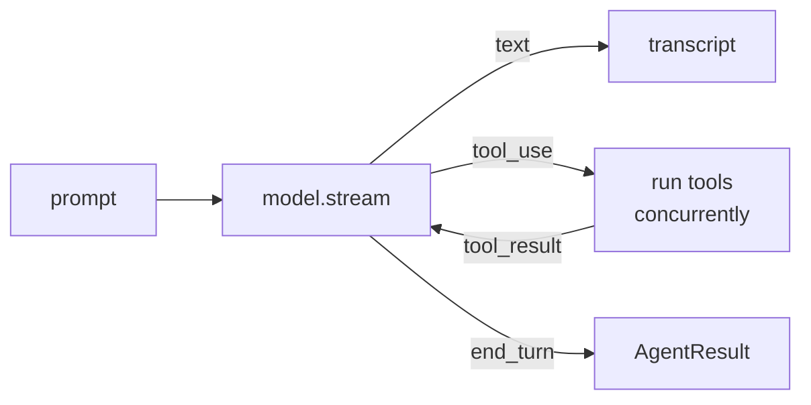

# Agent & event loop

`Agent` is an actor. Give it a `Model` and some tools; call it for the answer or stream every event.

```swift
// snippet: compile
import Loopl

func ask(_ model: any Model) async throws {
    let agent = Agent(model: model,
                      tools: [CurrentTimeTool(), CalculatorTool()],
                      systemPrompt: "You are a concise assistant.")

    let result = try await agent("What time is it in Istanbul, and what is 23 × 47?")
    print(result.text)                               // the final assistant text
    print(result.stopReason)                         // .endTurn
    print(result.metrics.cycleCount,                 // model calls in this invocation
          result.metrics.toolCallCount,              // tools that ran
          result.metrics.accumulatedUsage.totalTokens)
}
```

## The loop



1. **Stream** the model. Text deltas are yielded as they arrive; tool-use blocks are assembled.
2. **Run tools** — all calls in the turn, concurrently (`ConcurrentToolExecutor`). Results are appended as a user message.
3. **Recurse** while the stop reason is `toolUse`. The only bounds are the context window and cancellation. No `maxIterations`, no loop detector — same as Strands.

Before a tool runs, its input is checked against the tool's JSON schema (Strands
`validate_and_prepare_tools`). A call a small model broke never reaches the tool: it gets an
error `ToolResult` in its place — so the toolUse and toolResult lists stay paired and the model
reads what it did wrong and usually fixes it next cycle. Quoted numbers (`"3"`), `"yes"` for a
boolean and a single bare-string argument are coerced rather than refused; a missing required
field, a genuinely wrong type, a duplicate `toolUseId` or an invalid tool name are refused with
the expected shape. `ToolValidation.coerce(_:to:)` is public if you want the check on its own.

Also ported: throttle retries (`ModelRetryStrategy`, 6 attempts, 4 → 240 s backoff), context-overflow trimming via the [conversation manager](hooks.md), and `maxTokens` recovery — the partial turn is kept and `MaxTokensReachedError` is thrown so you can simply call again:

```swift
// snippet: compile
import Loopl

func askResilient(_ agent: Agent, _ prompt: String) async throws -> AgentResult {
    do { return try await agent(prompt) }
    catch is MaxTokensReachedError { return try await agent() }      // the partial turn is already in history
}
```

## Stream

`agent.stream(_:)` yields `AgentEvent`s — the same names as Strands' typed events, as a Swift enum.

```swift
// snippet: compile
import Loopl

func show(_ agent: Agent, _ prompt: String) async throws {
    for try await event in agent.stream(prompt) {
        switch event {
        case .text(let delta):          print(delta, terminator: "")
        case .reasoning(let delta):     print("💭 \(delta)", terminator: "")
        case .toolStarted(let use):     print("\n→ \(use.name) \(use.input)")
        case .toolResult(let r):        print("← \(r.name): \(r.content.prefix(80))")
        case .throttle(let s):          print("⏳ model busy, retrying in \(Int(s)) s")
        case .forceStop(let why):       print("✗ \(why)")
        case .result(let r):            print("\n— \(r.stopReason), \(r.metrics.cycleCount) cycles")
        default: break
        }
    }
}
```

| `AgentEvent` | when |
|---|---|
| `.startEventLoop(cycle:)` | each model call |
| `.text` / `.reasoning` | content deltas |
| `.toolUseStream` → `.toolStarted` → `.toolResult` | a tool call's life |
| `.modelMessage` / `.toolResultMessage` | messages appended to history |
| `.throttle(delay:)` / `.forceStop` | retry · unrecoverable stop |
| `.metrics` | tok/s, TTFT, context used (loopl addition) |
| `.result` | last event on success |

For SwiftUI, `Transcript` folds events into rows — `LooplUI` renders it.

## Interrupts

A hook or a tool can stop mid-loop and ask a human. One mechanism, two shapes:

- **`.suspend`** (default) — only the call that raised it waits, inside the actor. The stream
  stays alive, the other tools of the same message keep running, and the UI answers with
  `agent.resolve(interrupt:response:)`. Tool approval ([Human in the loop](hitl.md)) is exactly
  this with a nicer card.
- **`.stop`** — Strands' shape: the loop stops, `result.stopReason == .interrupt`,
  `result.interrupts` lists the questions, and you resume later. Tool results already produced
  are kept and **not re-run**, and the resumed cycle replays the assistant message instead of
  calling the model again.

```swift
// snippet: compile
import Loopl

/// A tool that needs a number from the human before it can finish.
struct AskingTool: Tool {
    let name = "ask_budget"
    let description = "ask the human for a budget"
    let parameters: JSONValue = ToolSchema.object([:])
    func call(_ args: [String: JSONValue]) async throws -> String {
        let answer = try InterruptScope.interrupt("budget", reason: .string("how much may I spend?"))
        return "budget = \(answer.compact)"
    }
}

func runWithStop(_ model: any Model) async throws {
    let agent = Agent(model: model, tools: [AskingTool()], interruptMode: .stop)
    var result = try await agent("book the cheapest flight")
    while result.stopReason == .interrupt {
        let answers = result.interrupts.map {
            InterruptResponse(interruptId: $0.id, response: .number(500))     // ask the human here
        }
        result = try await agent.resume(answers)
    }
    print(result.text)
}
```

`InterruptScope.interrupt` throws the first time and returns the answer when the tool body runs
again — so a tool is written once and resumes where it stopped.

## Persist

`Message` is `Codable`; the history is the whole state. For metrics, the system prompt and what a run was suspended on, snapshot the lot — [Checkpoints](checkpoints.md).

```swift
// snippet: compile
import Loopl
import Foundation

func save(_ agent: Agent, to url: URL) async throws {
    let data = try JSONEncoder().encode(await agent.messages)
    try data.write(to: url)
}

func restore(_ model: any Model, from url: URL) throws -> Agent {
    let messages = try JSONDecoder().decode([Message].self, from: Data(contentsOf: url))
    return Agent(model: model, messages: messages)
}
```

## Strands → loopl

| Strands | loopl |
|---|---|
| `agent("…")` / `agent.stream_async` | `try await agent("…")` / `agent.stream` |
| `event_loop_cycle` / `recurse_event_loop` | `Agent.eventLoopCycle` (private, recursive) |
| `ModelThrottledException` · `ContextWindowOverflowException` · `MaxTokensReachedException` | `ModelThrottledError` · `ContextWindowOverflowError` · `MaxTokensReachedError` |
| `StopReason` strings | `StopReason` enum (+ `.cancelled`) |
| `TypedEvent` classes | `AgentEvent` cases |
| `Interrupt` · `InterruptException` · `PendingToolExecution` · `_InterruptState` | same names; `InterruptMode.stop` is Strands' behaviour, `.suspend` is loopl's in-process default |
| `event.interrupt(name, reason=…)` on hook events · `ToolContext.interrupt` | `try event.interrupt("name", reason:)` (`InterruptibleEvent`) · `try InterruptScope.interrupt("name")` inside a tool |
| `validate_and_prepare_tools` | `ToolValidation.validateAndPrepare(toolUses:tools:)` + coercions for small-model JSON |
| `after_tools_event.end_turn` · `request_state["stop_event_loop"]` | `AfterToolsEvent.endTurn` · `AfterToolsEvent.requestState["stopEventLoop"]` |
| `_estimate_input_tokens` (usage baseline) | the last model call's measured usage + an estimate of only the new messages (`EventLoopMetrics.usageBaselineTokens`) |
| — (no built-in HITL; `BeforeToolCallEvent` cancel + interrupts) | `Tool.requiresApproval` → `.approvalRequested` suspends the call, `agent.resolve(approval:)` resumes, `ApprovalPolicy` hook decides ([Human in the loop](hitl.md)) |
| `structured_output_model=…` (Pydantic + forced `tool_choice`) | `agent.structured(As:prompt:)` — schema from `Decodable`, forced pass with that tool only ([Structured output](structured-output.md)) |
| `SessionManager` / `SnapshotSessionManager` | `AgentCheckpoint` + `CheckpointStore` ([Checkpoints](checkpoints.md)) |
| `telemetry/tracer.py` (OTel SDK) | `Tracer` — `gen_ai.*` spans from hooks, no dependency ([Tracing](tracing.md)) |

Deliberate differences: `maxTokens` throws after recovering the message; cancellation keeps partial text; roles are `user` / `assistant` only.
