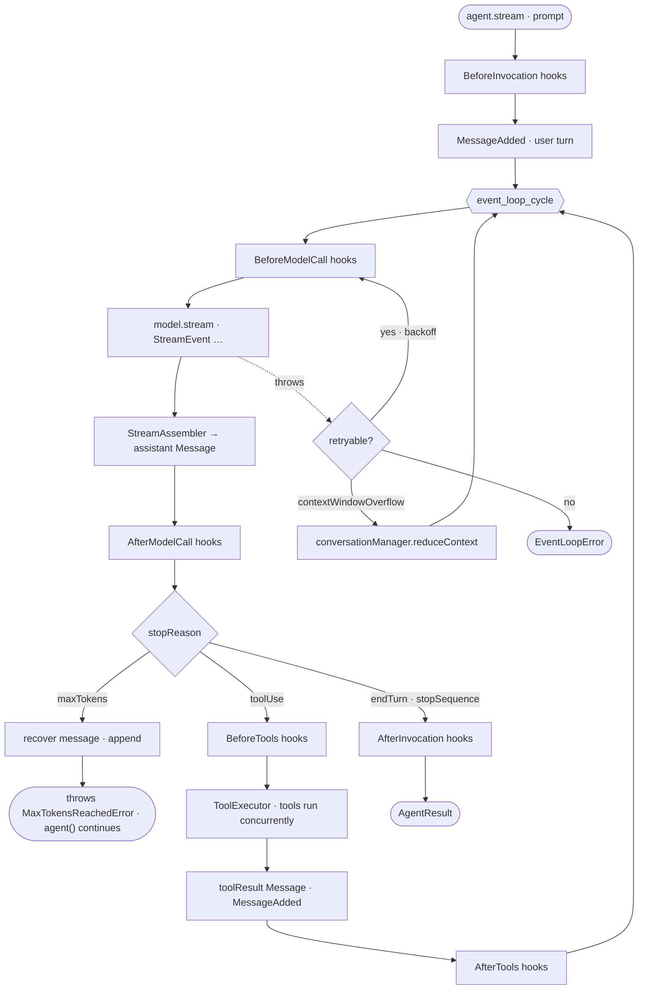

# The event loop

loopl's agent loop is a port of the Strands Agents **event loop** (`strands.event_loop.event_loop_cycle`
in Python, `EventLoop` in TypeScript) to Swift concurrency. If you know Strands, you know this page;
the names are the same wherever Swift allows it — see the [Strands mapping](strands-mapping.md).

!!! strands "What is different from Strands"
    **Nothing stops the loop except the model, the context window or you.** There is no
    `max_iterations`, no loop detector, no budget. A phone has no API bill to protect; the user is holding
    a Stop button. The only limits are physical — the context window (the conversation manager keeps you
    inside it) — and cancellation (`Task.cancel()`).

## One cycle



Every box is observable: the `for try await event in agent.stream(…)` loop receives an `AgentEvent`
for each step, and every hook event can be subscribed to with `agent.hooks`.

### 1 · Stream the model

The `Model` yields `StreamEvent`s — the Bedrock-shaped vocabulary Strands uses for every provider:

| `StreamEvent`              | Strands                | Meaning                                                   |
|----------------------------|------------------------|-----------------------------------------------------------|
| `.messageStart(role:)`     | `messageStart`         | A new assistant message begins                             |
| `.contentBlockStart`       | `contentBlockStart`    | Text block, or a tool use with `name` + `toolUseId`        |
| `.contentBlockDelta`       | `contentBlockDelta`    | Text delta · reasoning delta · tool-input JSON fragment    |
| `.contentBlockStop`        | `contentBlockStop`     | Block complete                                             |
| `.messageStop(StopReason)` | `messageStop`          | `endTurn` · `toolUse` · `maxTokens` · `stopSequence` · …   |
| `.metadata(Metrics)`       | `metadata`             | Usage + latency                                            |

`StreamAssembler` (Strands `process_stream`) folds them into one assistant `Message` while forwarding
`AgentEvent.text`, `.reasoning` and `.toolUseStream` to the UI as they arrive. A runtime that does not
stream natively (Apple Foundation Models' snapshots, llama.cpp tokens) is adapted to this same vocabulary
inside its `Model` implementation — the loop never knows.

### 2 · Decide on the stop reason

| `StopReason`      | What the loop does                                                                              |
|-------------------|-------------------------------------------------------------------------------------------------|
| `.endTurn`        | Finish: `AfterInvocationEvent` hooks, then `AgentResult` (`.result` is the last event of a successful stream). |
| `.stopSequence`   | Same as `endTurn`.                                                                              |
| `.toolUse`        | Run every tool use in the message (step 3), append the tool-result message, **recurse**.         |
| `.maxTokens`      | Recover the partial message, append it, **throw `MaxTokensReachedError`** (step 4).               |
| `.contentFiltered`| Finish with the message as-is.                                                                  |
| `.cancelled`      | The task was cancelled mid-stream. The partial assistant message is kept in `agent.messages`.    |

### 3 · Run the tools — concurrently

Strands runs tool uses through a `ToolExecutor`; the default is `ConcurrentToolExecutor`. loopl does the same with a
`TaskGroup`: all tool uses of one assistant message run **in parallel** and their `ToolResult`s are collected into a single
`user` message in the original order (the order the model asked for, which is what the model expects back).
`SequentialToolExecutor` exists for tools that must not overlap (a camera, a single BLE connection).

Each tool call is wrapped in `BeforeToolCallEvent` / `AfterToolCallEvent` hooks — a hook may **replace** the tool (mock it, deny
it, route it elsewhere), and a tool that throws becomes a `ToolResult(status: .error)` the model can read, never a crash.

### 4 · `maxTokens` recovery

When the model's output cap cuts a tool call in half, Strands' `recover_message_on_max_tokens_reached` replaces the
truncated `toolUse` block with a text block that explains what happened, appends that message to the history and then
raises `MaxTokensReachedException` — the caller decides whether to continue. loopl mirrors this exactly: the recovered
message is appended, `MaxTokensReachedError` is thrown out of `agent(…)` / the stream, and `try await agent()` with no
argument continues from the history (Strands' `agent(prompt=None)`). On a phone this matters more, because small
contexts make `maxTokens` common — and nothing is lost: the partial message is in `agent.messages`.

### 5 · Retries

A model call that throws a *retryable* error — `ModelThrottledError` in Strands terms; on-device that is a Metal
out-of-memory while another app holds the GPU, or a model still warming up — is retried with exponential backoff:
`4 s → 8 s → 16 s → 32 s → 64 s`, six attempts, exactly Strands' `ModelRetryStrategy` defaults. Each wait is announced as
`AgentEvent.throttle(delay:)` so the UI can show it. Anything else surfaces as `EventLoopError` with the original error
attached.

### 6 · The context window is the only limit

`ContextWindowOverflowError` is the one error the loop handles by **shrinking the conversation**: it asks the
`ConversationManager` to `reduceContext` and retries the cycle. The default `SlidingWindowConversationManager`
drops the oldest turns — never splitting a `toolUse` from its `toolResult` — and, when a single message is too large,
truncates the tool results inside it (Strands' `truncate_results`). Because it also runs `applyManagement` after every
appended message (as a `MessageAddedEvent` hook, like Strands), an unlimited loop never grows past the window in the first place.

## What you see as the caller

```swift
// snippet: compile
import Loopl

func run(_ model: any Model) async throws {
    let agent = Agent(model: model, tools: [CurrentTimeTool(), CalculatorTool()])

    for try await event in agent.stream("Plan my morning: time in Tokyo, then 3 × 17.") {
        switch event {
        case .startEventLoop(let cycle): print("cycle \(cycle)")
        case .text(let delta):           print(delta, terminator: "")
        case .toolStarted(let use):      print("→ \(use.name)")
        case .toolResult(let result):    print("← \(result.content)")
        case .throttle(let delay):       print("retrying in \(delay)s")
        case .result(let r):             print("\ndone: \(r.stopReason) after \(r.metrics.cycleCount) cycles")
        default: break
        }
    }
}
```

`.result` is the last event of a stream that finished. When the loop ends on an unrecoverable error, `.forceStop(reason)`
is yielded and the stream **throws** (`EventLoopError`, `MaxTokensReachedError`, `ContextWindowOverflowError` when nothing
could be trimmed); cancellation finishes with a `.result` whose `stopReason == .cancelled`.

## Hooks — the order of events in one invocation

1. `BeforeInvocationEvent`
2. `MessageAddedEvent` (the user turn)
3. per cycle: `BeforeModelCallEvent` → `AfterModelCallEvent` → `MessageAddedEvent` (assistant) →
   if tools: `BeforeToolsEvent` → (`BeforeToolCallEvent` → `AfterToolCallEvent`) × n → `MessageAddedEvent` (tool results) → `AfterToolsEvent`
4. `AfterInvocationEvent`

`After…` hooks run in **reverse registration order**, as in Strands, so wrappers unwind cleanly. See [Hooks](hooks.md).

## Cancellation

`agent.stream` is an `AsyncThrowingStream`: leaving the `for try await` loop, or cancelling the enclosing `Task`, cancels
the model stream and every in-flight tool. The partial assistant message stays in `agent.messages` with
`stopReason == .cancelled`, so the next prompt continues from a consistent history — exactly what the app's Stop button does.
