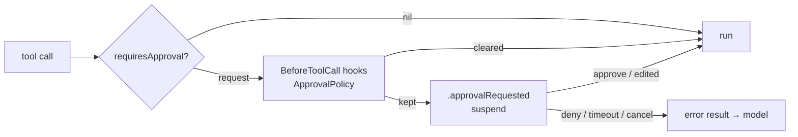

# Human in the loop

A tool flags an input; loopl **suspends that one call inside the `Agent` actor**, emits an event, and resumes when a person answers. The other tools of the same message keep running.



## Flag a call

A `Tool` returns an `ApprovalRequest` for sensitive inputs. `HttpTool` does for every call, graded by method — GET and HEAD low, POST, PUT and PATCH medium, DELETE high — with credential headers redacted.

## Decide what asks

`ApprovalPolicy` is a `BeforeToolCallEvent` hook: `.mutating` (app default) runs low-risk calls and asks for writes, `.always` asks for everything, `.never` never asks; trusted hosts pass. Any hook may set or clear `event.approval` for any tool.

## Answer

```swift
// snippet: compile
import Loopl

func run(_ model: any Model) async throws {
    let agent = Agent(model: model, tools: [HttpTool()],
                      hooks: [ApprovalPolicy(mode: .mutating, trustedHosts: ["api.example.com"])],
                      approvalTimeout: 120)
    for try await event in agent.stream("Post today's summary to the notes API.") {
        switch event {
        case .approvalRequested(let request):
            // Show the card; answer later, from any task:
            await agent.resolve(approval: request.id, .approve)   // or .deny(reason:), .approveEdited(input)
        case .toolResult(let result) where result.isError:
            print(result.content)   // a denial is an error result — the model is told and continues
        default: break
        }
    }
}
```

No answer within `approvalTimeout` (default 120 s) denies the call; so does cancelling the stream. `agent.pendingApprovals` lists what is waiting.

## In SwiftUI

`Transcript` folds the events into `TranscriptItem.Kind.approval`; `AgentTranscriptView` renders an `ApprovalCard` inline — method badge, host and path, redacted headers, collapsible body, **Approve · Deny · Edit** (the editor rewrites the input first). Route answers with `.onApproval { request, decision in … }`. Motion uses `LooplDesign.Motion`, haptics `HapticEvent.approvalNeeded`, and Reduce Motion crossfades. In the app, **Settings › Ask before** sets the policy.

## Strands

Strands has no built-in approval step — its closest primitives are a `BeforeToolCallEvent` hook that cancels the tool, and interrupts. loopl keeps that hook as the policy surface and adds the suspend/resume half.
