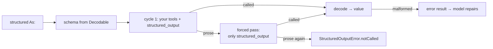

# Structured output

Ask for a value, get a value:

```swift
// snippet: compile
import Loopl

struct Weather: Codable, Sendable {
    let city: String
    let celsius: Int
    let summary: String?
}

func report(_ agent: Agent) async throws -> Weather {
    try await agent.structured(As: Weather.self, prompt: "Weather in Istanbul right now")
}
```

How it works: the JSON schema of `Weather` is **derived from its `Decodable` conformance** and offered to the model as one tool, `structured_output`. When the model calls it, the arguments *are* the answer — they decode straight into `Weather` and the invocation ends there.



## Forcing

A cloud API has `tool_choice`; an on-device runtime does not. loopl forces the same way a local model actually responds to: the retry pass offers **only** the `structured_output` tool and says so in the prompt. One retry by default; if the model still writes prose, `StructuredOutputError.notCalled` is thrown with its last answer, never a guess.

Malformed input is not a failure either — it is returned to the model as an error tool result naming the missing or mistyped field ("missing required field \"celsius\""), which it can fix in the next cycle. `maxRepairs` (default 1) bounds that, then `StructuredOutputError.decodingFailed` is thrown.

Nothing extra is generated once the value is in: a hook ends the invocation at that point instead of letting the model write a summary nobody reads.

## Tune it

```swift
// snippet: compile
import Loopl

struct Reading: Codable, Sendable { let city: String; let celsius: Int }

func tuned(_ model: any Model) async throws {
    let agent = Agent(model: model, tools: [CalculatorTool()])
    var options = StructuredOutputOptions()
    options.describe = ["city": "City name, as the user wrote it", "celsius": "Temperature in °C"]
    options.withTools = true          // cycle 1 may still call calculator etc. (default)
    options.maxRepairs = 2
    options.discardHistory = true     // leave the conversation untouched
    let run = try await agent.structuredRun(As: Reading.self, prompt: "weather in Izmir", options: options)
    print(run.value.city, run.forced, run.repairs, run.result.metrics.cycleCount)
}
```

`StructuredRun` carries the value plus what it cost: the final `AgentResult` (stop reason, metrics), whether the forced pass was needed, how many repairs happened.

## Schemas

`JSONSchema.derive(_:describe:description:)` decodes your type from a probing decoder and records what it asks for:

| Swift | schema |
|---|---|
| `String` · `Int` · `Double` · `Bool` | `string` · `integer` · `number` · `boolean` |
| `T?` | present, **not** in `required` |
| nested `Codable` struct | nested `object` |
| `[T]` | `array` with `items` |
| `Date` · `URL` · `UUID` · `Data` | `string` with `date-time` · `uri` · `uuid` · base64 (dates are ISO-8601) |
| `enum E: String, Codable, SchemaEnum` | `string` + `enum: [...]` |

Two types cannot be probed: one whose `init(from:)` validates its input, and a recursive one. Both are honest errors (`SchemaDerivationError`) that tell you to declare the schema:

```swift
// snippet: compile
import Loopl

struct Rating: Codable, Sendable, JSONSchemaProviding {
    let stars: Int
    static var jsonSchema: JSONValue {
        ToolSchema.object(["stars": ToolSchema.number("1 to 5")], required: ["stars"])
    }
}
```

Swift has no per-property doc comments at runtime, so prose for the model goes in `describe:` (paths like `"address.city"` work) — or in a declared schema.

## Runtimes

| Runtime | Structured output |
|---|---|
| **MLX** | Works. The chat template renders the tool, `ToolCallStreamGate` turns the model's call into a `toolUse`. |
| **llama.cpp (GGUF)** | Works. `PromptBuilder`'s hermes dialect renders the tool; the same gate parses `<tool_call>` JSON. |
| **Apple Intelligence** | Best effort. The runtime prompts for tool calls rather than using Apple's own tool API, so a 3B on-device model may answer in prose; the forced pass usually fixes it, and when it does not you get `notCalled` instead of an invented value. `FoundationModels`' native guided generation is not wired up yet. |

Smaller models do better with fewer fields, shorter names and a `describe:` line each. A 0.6B model will fill a six-field schema wrong more often than a 1.7B.

API: `StructuredOutputOptions` · `StructuredRun` · `StructuredOutputError` · `StructuredOutputTool` · `StructuredSink` · `JSONSchema` · `JSONSchemaProviding` · `SchemaEnum` · `SchemaDerivationError`.

## Strands

| Strands | loopl |
|---|---|
| `structured_output_model=Weather` on the invocation | `agent.structured(As: Weather.self, prompt:)` |
| Pydantic model → schema | `Decodable` → `JSONSchema.derive` (or `JSONSchemaProviding`) |
| `StructuredOutputTool` + `tool_choice: any` | `StructuredOutputTool` + forced pass with that tool only |
| "You must format the previous response as structured output." | `StructuredOutputOptions.forcePrompt` |
| `stop_loop` after the tool call | `BeforeModelCallEvent.cancel` from the same place |
