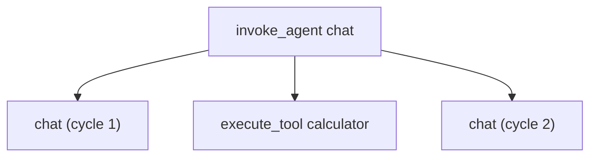

# Tracing

`Tracer` is a `HookProvider`. Add it and every invocation becomes a span tree:

```swift
// snippet: compile
import Loopl

func traced(_ model: any Model) async throws {
    let tracer = Tracer(agentName: "chat")
    let agent = Agent(model: model, tools: [CalculatorTool()], hooks: [tracer])
    for try await event in agent.stream("What is 23 × 47?") {
        if case .metrics(let m) = event { tracer.record(m, runtime: .mlx, modelId: "qwen3-1.7b-4bit") }
    }
    for span in tracer.spans {
        print(span.name, Int(span.durationMs ?? 0), "ms", span.status.rawValue)
    }
}
// chat 412 ms ok · execute_tool calculator 1 ms ok · chat 380 ms ok · invoke_agent chat 795 ms ok
```



One root span per invocation, a `chat` child per model call, an `execute_tool` child per tool — concurrent tools are matched by `toolUseId`, so parallel calls keep their own spans. Trace and span ids are 32/16 hex characters and the attribute names are OpenTelemetry's GenAI semantic conventions (`gen_ai.operation.name`, `gen_ai.usage.input_tokens`, `gen_ai.tool.name`, …, plus `loopl.tokens_per_second` and `loopl.runtime`, which OTel has no convention for). `SpanAttribute` has the constants so you match on those instead of string literals.

## No dependency, no network

loopl does not link OpenTelemetry. `Span` is a plain `Codable` struct, and `tracer.otlpJSON()` returns the OTLP/JSON body a collector accepts at `POST /v1/traces` — whether to send it, where and when, is the host's call:

```swift
// snippet: compile(wrap)
let tracer = Tracer()
let body = tracer.otlpJSON(serviceName: "my-app").compact      // ready to POST
_ = body.count
```

## Nothing leaves the process by accident

`recordContent` is **off**. Spans carry shapes and numbers — token counts, durations, tool names, stop reasons — not prompts, answers, tool arguments or tool results. Turn it on deliberately, for a debug build:

```swift
// snippet: compile(wrap)
let tracer = Tracer(agentName: "chat", options: .init(recordContent: true, keep: 256))
_ = tracer.spans
```

`keep` bounds what the tracer holds (FIFO, default 512); `keep: 0` plus `onSpanEnd:` streams spans straight to your own sink and stores nothing.

## What you get per span

| Span | Attributes |
|---|---|
| `invoke_agent <name>` | finish reason, accumulated input/output tokens, `loopl.event_loop.cycles`, `loopl.tool_calls`, one `gen_ai.*.message` event per appended message |
| `chat` | cycle number, context window, projected input tokens, tool-call count, finish reason, retry flag — plus `gen_ai.usage.*`, TTFT and tok/s from `tracer.record(_:)` |
| `execute_tool <tool>` | tool name, tool-use id, duration, `loopl.tool.unknown`, error status with the message |

A failure marks the span `error` with the message, and an invocation that throws mid-flight closes its open spans rather than leaking them.

`record(_:)` exists because the runtime's measured numbers (tok/s, TTFT) arrive as an `AgentEvent.metrics`, not a hook: feed them in from your stream consumer and they land on that cycle's `chat` span.

API: `Tracer` · `Span` · `SpanEvent` · `SpanAttribute`.

## Strands

| Strands | loopl |
|---|---|
| `telemetry/tracer.py` + the OTel SDK | `Tracer`, hooks only, no dependency |
| `start_model_invoke_span` / `start_tool_call_span` | `chat` / `execute_tool` spans |
| OTLP exporter, env-configured | `tracer.otlpJSON()`, the host posts it |
| `gen_ai.*` semantic conventions | the same names (`SpanAttribute`) |
| `EventLoopMetrics` | `EventLoopMetrics` (unchanged) + span attributes |

Strands sends traces by default when an endpoint is configured. On a phone that would be a surprise, so loopl never sends anything.
